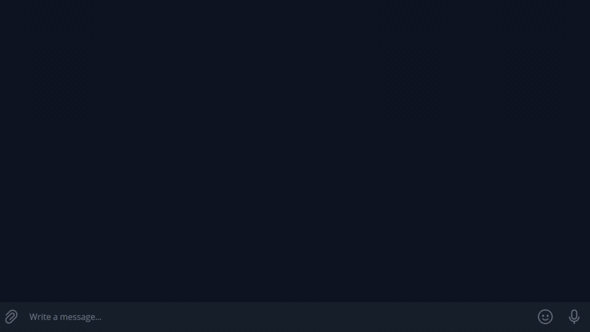

# tgscreens

[](https://github.com/greg-source/tgscreens/actions/workflows/ci.yml)
[](https://pkg.go.dev/github.com/greg-source/tgscreens)

Build conversational Telegram bots in Go — the whole bot from one constructor.

tgscreens handles user state, routing and navigation for you, so even a bot with complex
multi-step flows is one constructor call — and the code you write is your actual domain logic.

**[Docs](docs/guide.md) · [Examples](examples/) · [API reference](https://pkg.go.dev/github.com/greg-source/tgscreens) · [Report a bug](https://github.com/greg-source/tgscreens/issues)**

## Install

```bash
go get github.com/greg-source/tgscreens@latest
```

Requires Go 1.25 or newer.

## Quickstart

A bot is states, actions, a few handlers, and one `Config` literal. This is the whole of
[`examples/echo`](examples/echo/main.go), the smallest bot: a state, a button, and a counter.

States and actions are values you choose:

```go
const (
	stateMain tgscreens.State  = 0
	actPing   tgscreens.Action = "ping"
)
```

Handlers mutate the user and show screens; they never save, and they never touch navigation
state directly:

```go
func (b *bot) onMessage(ctx context.Context, mc tgscreens.MessageContext, user *tgscreens.User) error {
	return b.Show(ctx, user, 0, tgscreens.Screen{
		Text:    "💬 You said: " + mc.Text,
		Buttons: pingButton(1),
	})
}

func (b *bot) onPing(ctx context.Context, cc tgscreens.CallbackContext, user *tgscreens.User) error {
	n := cc.ArgInt(0)
	return b.Show(ctx, user, cc.MessageID, tgscreens.Screen{
		Text:    fmt.Sprintf("🏓 Pong #%d", n),
		Buttons: pingButton(n + 1),
	})
}
```

Everything the bot supplies goes in one `Config`:

```go
	b.Router = tgscreens.New(sender, tgscreens.Config{
		LoadUser: b.loadUser,
		SaveUser: b.saveUser,

		MessageHandlers: map[tgscreens.State]tgscreens.MessageHandlerFunc{
			stateMain: b.onMessage,
		},
		CallbackHandlers: map[tgscreens.Action]tgscreens.CallbackHandlerFunc{
			actPing: b.onPing,
		},

		OnUnknownMessage:  b.onMessage,
		OnUnknownCallback: ignoreCallback,
		OnError:           logError,
		OnAction:          logAction,
	})
```

Then connect a transport and listen:

```go
	b := newBot(client)
	if err := b.Listen(ctx, telegram.NewPoller(client).Poll); err != nil && !errors.Is(err, context.Canceled) {
		log.Fatal(err)
	}
```

Run it with a bot token from [@BotFather](https://t.me/BotFather):

```bash
TELEGRAM_TOKEN=123456:ABC... go run ./examples/echo
```

Next, read the [Guide](docs/guide.md): it explains how state, screens, and the navigation message fit
together, and how to connect a bot to Telegram.

## Examples

| Example | Shows                                                                                                               |
| --- |---------------------------------------------------------------------------------------------------------------------|
| [`examples/echo`](examples/echo/main.go) | One state, one inline button, long polling.                                                                         |
| [`examples/menu`](examples/menu/main.go) | A reminder bot: a reply keyboard, a text-entry state, a paged list, an on/off settings toggle, background delivery. |
| [`examples/webhook`](examples/webhook/main.go) | The echo bot served through a webhook with its own certificate.                                                     |

### Reminder bot

<p align="center">
  
</p>

## Documentation

Start with the [Guide](docs/guide.md). [Screens and callbacks](docs/screens.md) covers screens,
paged lists, and callback data.

## Contributing

Issues and pull requests are welcome; see [CONTRIBUTING.md](CONTRIBUTING.md).

## License

[MIT](LICENSE)
